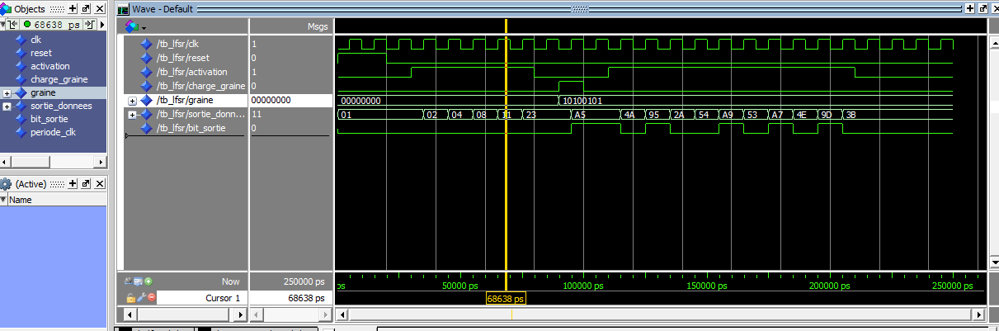
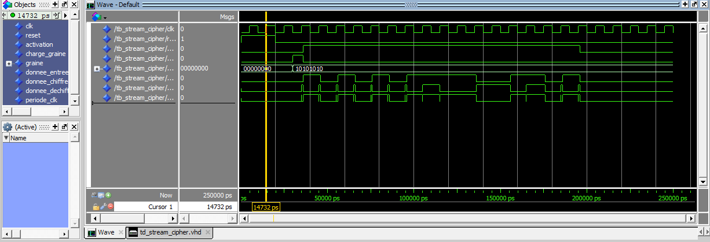

# Générateur LFSR pour Cryptographie (Linear Feedback Shift Register)

**LFSR 8 bits et chiffrement par flot (stream cipher) en VHDL**

Mini-projet VHDL réalisé dans le cadre de mon **apprentissage du VHDL (niveau débutant)**.
Il comporte deux blocs :

1. un **registre à décalage à rétroaction linéaire (LFSR) de 8 bits** ;
2. un **chiffrement par flot** simple qui utilise ce LFSR comme générateur de clé.

> **Objectif** : comprendre les bases du VHDL (entity / architecture, process synchrone,
> instanciation de composants, testbench auto-vérifiant) à travers un exemple concret de
> cryptographie matérielle.

---

## 1. Contenu du dépôt

| Fichier | Rôle |
|---|---|
| `src/lfsr.vhd` | Entité `lfsr` : LFSR 8 bits |
| `sim/tb_lfsr.vhd` | Testbench du LFSR (vérification visuelle sur chronogramme) |
| `src/stream_cipher.vhd` | Entité `stream_cipher` : chiffrement par flot (LFSR + XOR) |
| `sim/td_stream_cipher.vhd` | Testbench du chiffrement, **auto-vérifiant** (l'entité s'appelle `tb_stream_cipher`) |
| `sim/waveform_lfsr.png` | Chronogramme ModelSim du LFSR |
| `sim/waveform_stream_cipher.png` | Chronogramme ModelSim du chiffrement |

---

## 2. Le LFSR (`lfsr.vhd`)

### Principe

Un registre de 8 bits qui se décale d'un cran vers la gauche à chaque front montant d'horloge.
Le nouveau bit entrant (bit 0) est le **XOR des bits 7, 5, 4 et 3** :

```vhdl
registre(7 downto 0) <= registre(6 downto 0) &
                        (registre(7) xor registre(5) xor registre(4) xor registre(3));
```

Cela correspond au polynôme **x⁸ + x⁶ + x⁵ + x⁴ + 1**, qui est primitif : le LFSR parcourt
**les 255 états non nuls** avant de revenir à son état de départ (**période = 255**,
vérifié par un petit calcul en Python).

### Ports

| Port | Sens | Type | Description |
|---|---|---|---|
| `clk` | in | `std_logic` | Horloge (front montant) |
| `reset` | in | `std_logic` | Reset synchrone, remet le registre à `01` |
| `activation` | in | `std_logic` | Autorise le décalage |
| `charge_graine` | in | `std_logic` | Charge la graine (seed) dans le registre |
| `graine` | in | `std_logic_vector(7 downto 0)` | Valeur de la graine |
| `sortie_donnees` | out | `std_logic_vector(7 downto 0)` | Contenu complet du registre |
| `bit_sortie` | out | `std_logic` | Bit de poids fort (bit 7) : le bit de clé |

### Comportement

Priorité des commandes (de la plus forte à la plus faible) : `reset` > `charge_graine` > `activation`.

- **État initial / reset** : `01`.
- **Protection contre l'état nul** : si la graine vaut `00`, elle est remplacée par `01`.
  Un LFSR à l'état `00` resterait bloqué à `00` pour toujours.

---

## 3. Le chiffrement par flot (`stream_cipher.vhd`)

Architecture structurelle très simple :

```
donnee_sortie = donnee_entree XOR bit_sortie(LFSR)
```

Le LFSR produit un flux de bits (le *keystream*) et chaque bit du message est combiné
par un XOR avec le bit de clé correspondant.
Comme `(m XOR k) XOR k = m`, **la même opération sert à chiffrer et à déchiffrer**
(avec la même graine).

| Port | Sens | Description |
|---|---|---|
| `clk`, `reset`, `activation`, `charge_graine`, `graine` | in | Transmis au LFSR |
| `donnee_entree` | in | Bit de message (ou de message chiffré) |
| `donnee_sortie` | out | Bit chiffré (ou déchiffré) |

---

## 4. Simulation

### Lancer avec ModelSim

```tcl
vcom src/lfsr.vhd src/stream_cipher.vhd sim/tb_lfsr.vhd sim/td_stream_cipher.vhd

# Testbench du LFSR
vsim work.tb_lfsr
add wave -r /*
run 250 ns

# Testbench du chiffrement
vsim work.tb_stream_cipher
add wave -r /*
run 250 ns
```

> L'horloge tourne indéfiniment : il faut donc donner une durée (`run 250 ns`)
> et non `run -all`.

### Testbench du LFSR (`tb_lfsr.vhd`)

Horloge de 10 ns. Scénario :

1. Reset initial.
2. Activation sans graine : le registre part de `01` (5 cycles).
3. Chargement de la graine `A5`.
4. Nouvelle activation pendant 10 cycles.

Résultat observé :

- Sans graine : `01 → 02 → 04 → 08 → 11 → 23`
- Après chargement de `A5` : `A5 → 4A → 95 → 2A → 54 → A9 → 53 → A7 → 4E → 9D → 3B`

Ces valeurs correspondent à celles calculées à la main avec la formule du XOR.



### Testbench du chiffrement (`td_stream_cipher.vhd`)

Le banc de test instancie **deux** `stream_cipher` :

- un **chiffreur** qui reçoit le message en clair ;
- un **déchiffreur** qui reçoit la sortie du chiffreur (même graine, même horloge).

Scénario :

1. Reset initial.
2. Chargement de la graine `AA`.
3. Envoi du message `ABCD` (16 bits, du bit 15 au bit 0), un bit par cycle d'horloge.

À chaque bit, le testbench vérifie automatiquement (`report ... severity error`) que :

- la sortie du chiffreur est égale au bit attendu de `0134` ;
- la sortie du déchiffreur est égale au bit d'origine de `ABCD`.

À la fin, un bilan est affiché dans la console : `TEST OK` ou `TEST ECHOUE : n erreur(s)`.

**Timing** : les entrées changent 1 ns après le front montant d'horloge, et les sorties sont
lues 1 ns plus tard, avant le front suivant. Il n'y a donc pas de conflit entre le
changement des entrées et l'évolution du LFSR.

Valeurs attendues (graine `AA`) :

| | Binaire | Hexa |
|---|---|---|
| Message | `1010 1011 1100 1101` | `ABCD` |
| Keystream | `1010 1010 1111 1001` | `AAF9` |
| Message chiffré | `0000 0001 0011 0100` | `0134` |



---

## 5. Limites et améliorations possibles

**Déjà fait** : vérification automatique du chiffrement, deuxième instance pour déchiffrer.

**À faire** :

- Ajouter des `assert` au testbench du LFSR (séquence `01, 02, 04, 08, 11, 23` et `A5, 4A, 95...`).
- Tester explicitement la graine `00` pour valider la protection (le registre doit valoir `01`).
- Simuler plus de 255 cycles pour vérifier la période du LFSR.
- Renommer `td_stream_cipher.vhd` en `tb_stream_cipher.vhd` pour qu'il corresponde au nom de l'entité.
- Faire travailler le chiffrement par **octets** (8 bits par cycle) au lieu d'un seul bit.

## 6. Remarque sur la sécurité

Ce projet est **purement pédagogique**. Une clé de 8 bits n'offre que 255 possibilités
(attaque par force brute immédiate), et un LFSR seul est linéaire : quelques bits de clair
connus suffisent pour retrouver son état (algorithme de Berlekamp-Massey).
Les chiffrements par flot réels combinent plusieurs LFSR avec des fonctions non linéaires
(par exemple A5/1 ou Trivium).

---

## 7. Outils

- Langage : VHDL
- Simulateur : ModelSim
